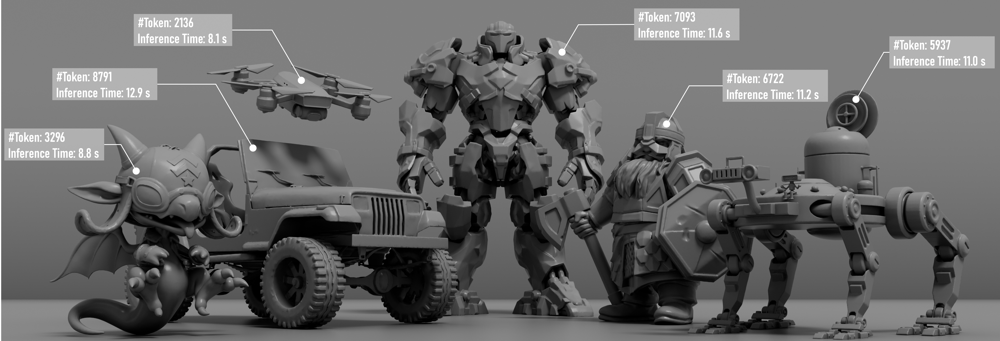
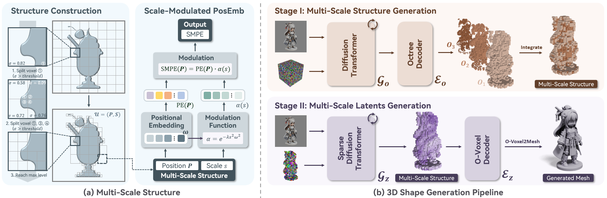

# Hierarchical Structured Latents for Efficient 3D Generation

[](LICENSE)

HSL-3D is a geometry-only image-to-3D generation framework based on hierarchical structured latents. Instead of allocating latent codes uniformly, HSL-3D uses a multiscale representation that assigns finer latents to geometrically complex regions and coarser latents to simpler regions.

## Method



The method follows a two-stage generation pipeline. Stage I generates a valid multiscale octree structure, and Stage II generates local shape latents conditioned on that structure. The resulting latents are decoded into an O-Voxel representation and converted to a mesh.

HSL-3D generates geometry only. Texture and PBR material generation are outside the scope of this repository.

## Installation

The provided setup script targets the following environment:

- Linux
- Python 3.10
- PyTorch 2.6
- CUDA 12.4
- An NVIDIA GPU with a CUDA toolkit available for compiling extensions

Clone the repository with its submodules:

```bash
git clone --recursive <REPOSITORY_URL>
cd HSL-3D
```

Create the `hsl3d` Conda environment and install the geometry-generation dependencies:

```bash
. ./setup.sh \
  --new-env \
  --basic \
  --flash-attn \
  --cumesh \
  --o-voxel \
  --flexgemm \
  --nvdiffrast
```

Run the setup help command to install components individually or to use an existing environment:

```bash
. ./setup.sh --help
```

## Quick Start

The inference pipeline performs Stage I octree generation followed by Stage II multiscale shape generation. The Stage II decoder is loaded from the model bundle's `pipeline.json`.

Run the end-to-end example:

```bash
python example.py \
  --model_path /path/to/model_bundle \
  --image_path /path/to/input.png \
  --output_dir outputs/example
```

The example writes:

```text
sample.ply  # Raw generated geometry
sample.glb  # Geometry-only GLB
sample.mp4  # Normal-map turntable video
```

Python API:

```python
from PIL import Image

from hsl3d.pipelines import HSL3DImageTo3DPipeline


pipeline = HSL3DImageTo3DPipeline.from_pretrained("/path/to/model_bundle")
pipeline.cuda()

image = Image.open("/path/to/input.png")
meshes = pipeline.run(image, seed=42)
mesh = meshes[0]
```

Advanced users can override the Stage I and Stage II sampler parameters independently:

```python
meshes = pipeline.run(
    image,
    stage1_sampler_params={"steps": 12, "guidance_strength": 7.5},
    stage2_sampler_params={"steps": 12, "guidance_strength": 7.5},
)
```

By default, image preprocessing removes the background and crops the foreground object. Set `preprocess_image=False` when providing an image that has already been prepared.

## Data Preparation

See [data_toolkit/README.md](data_toolkit/README.md) for dataset adapters, preprocessing commands, output layouts, and metadata fields.

The data pipeline is:

```text
Raw 3D assets
    -> normalized meshes
    -> O-Voxels
    -> hierarchical octrees
    -> image conditions
    -> octree and multiscale shape latents
```

## Training

Training is launched with `train.py`, while the model, dataset, and optimization settings are defined by the experiment configurations under `configs/`.

For example, train the Stage I Octree VAE with:

```bash
python train.py \
    --config configs/vae/octree_structure_vae_conv3d_16l8_fp16.json \
    --output_dir outputs/octree_structure_vae \
    --data_dir /path/to/processed_dataset \
    --num_gpus 8
```

Replace `--data_dir` with the path to the processed dataset and adjust `--num_gpus` to the number of GPUs available. The output directory stores the experiment configuration, training records, and model checkpoints. Other stages can be trained by selecting the corresponding configuration under `configs/`.

## License and Acknowledgements

Except for separately identified third-party components, the source code in this repository is released under the [MIT License](LICENSE).

HSL-3D is derived from [Microsoft TRELLIS.2](https://github.com/microsoft/TRELLIS.2). The original Microsoft copyright and MIT license notice are retained. HSL-3D also uses the O-Voxel representation and related geometry infrastructure originating from TRELLIS.2.

Third-party components and external model dependencies remain subject to their own license terms. Some optional dependencies are restricted to non-commercial research or evaluation use. See [NOTICE](NOTICE) and [THIRD_PARTY_NOTICES.md](THIRD_PARTY_NOTICES.md) for details.
